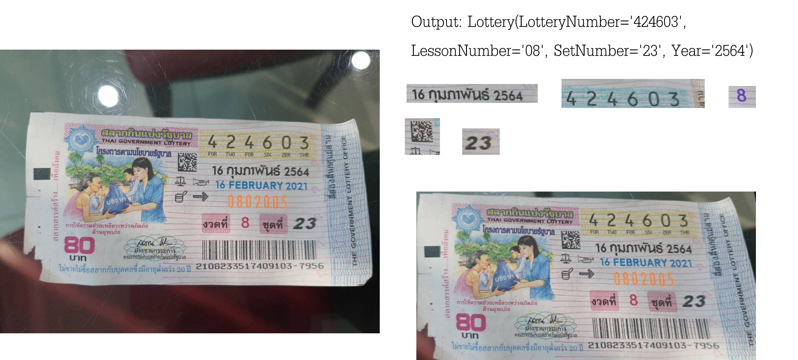
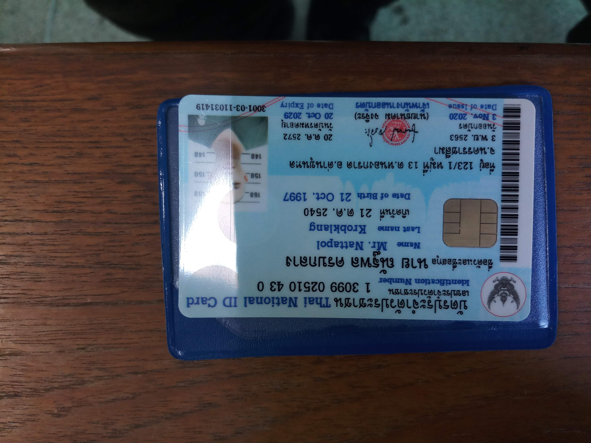
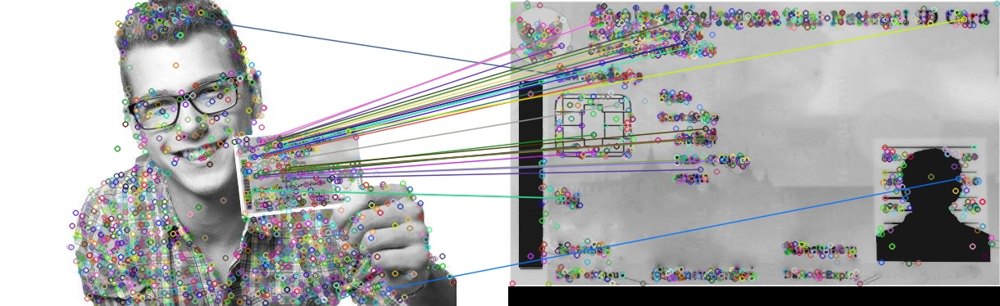
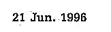
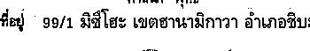
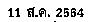
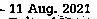
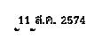
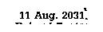

# ThaiPersonalCardExtract
[](http://pepy.tech/project/thai-personal-card-extract)
[](https://badge.fury.io/py/thai-personal-card-extract)
[](https://github.com/ggafiled/ThaiPersonalCardExtract/blob/master/LICENSE)
[](https://www.instagram.com/ggusfieldz)

Library for extract infomation from thai personal identity card. imprement from easyocr and tesseract

## New Feature v1.3.5 🎁
* Support Base64 input parameter for image object for all class. (14 Sep. 2021)
* Support Thai identity card laser code extract. (02 Sep. 2021)
* Fix bug dataset folder not import thai_government_lottery resource. (23 Aug. 2021) [#1](https://github.com/ggafiled/ThaiPersonalCardExtract/issues/1)
* Increase performance.
* Support Thai Government Lottery สกัดข้อมูลจากลอตเตอร์รี่ ใช้ได้ดีกับรูปภาพที่ได้จากเครื่องแสกน (16 Aug. 2021)
* Refactor Output Structure.
* Support Thai Driving License (Beta) สามารถสกัดข้อมูลจากภาพถ่ายใบขับขี่ได้บางรูปแบบ เนื่องจาก กรมทางขนส่งทางบก มีรูปแบบบัตรหลากหลายรูปแบบ และแต่ละรูปแบบมีตำแหน่งข้อมูลที่แตกต่างกัน จึงทำให้ประสิทธิภาพต่ำ

#### Example for new feature.
``` python
from ThaiPersonalCardExtract import PersonalCard
reader = PersonalCard(lang="mix", tesseract_cmd="D:/Program Files/Tesseract-OCR/tesseract") # for windows need to pass tesseract_cmd parameter to setup your tesseract command path.

# สำหรับตรวจจับภาพด้านหน้าบัตร
result = reader.extract_front_info("../examples/card1.jpg")
print(result)

# หรือหากต้องการส่งไฟล์ภาพเป็น ข้อมูลแบบเข้ารหัส base64 สามารถทำได้ดังนี้ 
# สามารถส่งข้อมูลแบบ base64 แทนการส่งที่อยู่ไฟล์แบบเดิมได้ในทุก class 
result = reader.extract_front_info("/9j/4AAQSkZJRgABAQEAeAB4AA....")
print(result)

# และด้านหลังบัตร
result = reader.extract_back_info("../examples/card5.jpg")
print(result)
```

## Examples
#### Example image file.




#### wrapPerpective image crop.


#### keypoint of image detected.


Resutls of library extract region of interest

| <p align="center"><kbd></kbd> </p>  <p align="center" class="image-caption">Identification Number</p> | <p align="center"><kbd></kbd></p>  <p align="center" class="image-caption">FullNameTH</p> |
|----------|------------|
| <p align="center"><kbd></kbd>  </p> <p align="center" class="image-caption">NameEN</p> | <p align="center"><kbd></kbd></p>  <p align="center" class="image-caption">LastNameEN</p> |
| <p align="center"><kbd></kbd>  </p> <p align="center" class="image-caption">BirthdayTH</p> | <p align="center"><kbd></kbd>  </p> <p align="center" class="image-caption">BirthdayEN</p> |
| <p align="center"><kbd></kbd> </p> <p align="center" class="image-caption">Religion</p>  | <p align="center"><kbd></kbd></p>   <p align="center" class="image-caption">Address</p> |
| <p align="center"><kbd></kbd>  </p> <p align="center" class="image-caption">DateOfIssueTH</p> | <p align="center"><kbd></kbd>  </p> <p align="center" class="image-caption">DateOfIssueEN</p> |
| <p align="center"><kbd></kbd>  </p> <p align="center" class="image-caption">DateOfExpiryTH</p> | <p align="center"><kbd></kbd>  </p> <p align="center" class="image-caption">DateOfExpiryEN</p> |
| <p align="center"><kbd></kbd>  </p> <p align="center" class="image-caption">LaserCode</p> |

## Recommend ⚠
* Image quality lowest should be 600x350
* Images with minimal reflections should be used. for good results
* Identity Card should be size in the image about 75%, if the image doesn't cropped that to be left only Identity Card  area.
* <b> For faster, please resize image and usage CUDA GPU. </b>

## Installation
Install using `pip` for stable release,

``` bash
pip install thai-personal-card-extract
```

For latest development release,

``` bash
pip install git+git://github.com/ggafiled/ThaiPersonalCardExtrac.git
```

<b>Note 1:</b> for Windows, please install tesseract first by following the official instruction here https://medium.com/@navapat.tpb/734dae2fb4d3 On medium website, be sure to setup already.

<b>Note 2:</b> for Linux os, please install tesseract by following the official instruction https://github.com/tesseract-ocr/tesseract

## Usage
``` python
# With build-in Config Options. For extractInfo function please use  <= v1.3.3 

import ThaiPersonalCardExtract as card
reader = card.PersonalCard(
    lang=card.THAI,
    provider=card.DEFAULT,
    tesseract_cmd="D:/Program Files/Tesseract-OCR/tesseract",
    save_extract_result=True,
    path_to_save="D:/dev/ThaiPersonalCardExtract/examples/extract")
result = reader.extractInfo('examples/card.jpg')
print(result)


# With free-style ตัวอย่างการเรียกใช้งานคลาส PersonalCard เพื่อสกัดข้อมูลบัตรประจำตัวประชาชน For extractInfo function please use  <= v1.3.3 

from ThaiPersonalCardExtract import PersonalCard
reader = PersonalCard(lang="mix", tesseract_cmd="D:/Program Files/Tesseract-OCR/tesseract") # for windows need to pass tesseract_cmd parameter to setup your tesseract command path.
result = reader.extractInfo('examples/card.jpg')
print(result)


# With free-style ตัวอย่างการเรียกใช้งานคลาส DrivingLicense เพื่อสกัดข้อมูลใบอนุญาตขับขี่

from ThaiPersonalCardExtract import DrivingLicense
reader = DrivingLicense(lang="mix", tesseract_cmd="D:/Program Files/Tesseract-OCR/tesseract") # for windows need to pass tesseract_cmd parameter to setup your tesseract command path.
result = reader.extractInfo('examples/card.jpg')
print(result)


# With free-style ตัวอย่างการเรียกใช้งานคลาส ThaiGovernmentLottery เพื่อสกัดข้อมูลลอตเตอร์รี่

from ThaiPersonalCardExtract import ThaiGovernmentLottery
reader = ThaiGovernmentLottery(save_extract_result=True, path_to_save="D:/dev/ThaiPersonalCardExtract/examples/extract/thai_government_lottery") # for windows need to pass tesseract_cmd parameter to setup your tesseract command path.
result = reader.extractInfo("../examples/card7.jpg")
print(result)
```

Output will be in list format, each item represents result of library can extract, respectively. type of namedtuple
ผลลัพธ์ที่ได้จะเป็นประเภท [namedtuple](https://docs.python.org/3/library/collections.html#collections.namedtuple) สามารถศึกษาเพิ่มเติมเพื่อใช้งานได้จากที่นี่ [คลิก](https://docs.python.org/3/library/collections.html#collections.namedtuple)

``` bash
#Output of PersonalCard
    Card(Identification_Number='9999999999999', FullNameTH='นาย อายุมฺมุราเสะ', PrefixTH='นาย', NameTH='อายุมฺมุราเสะ', LastNameTH='อายุมฺมุราเสะ', PrefixEN='.Mr.Shoyo', NameEN='', LastNameEN='Hinatao', BirthdayTH='21 มี.ย. 2539', BirthdayEN='21 Jun..1996', Religion='พุทธ', Address='ท8ปฺ` 99/1 มิซีโฮะ เขตฮานามิกาวา อำเภอชิบ', DateOfIssueTH='11 ส.ค. 2554', DateOfIssueEN='11 Ang. 2021', DateOfExpiryTH='11 ส.ค. 2574', DateOfExpiryEN='11 Aug. 2031,')

#Output of DrivingLicense
    Card(License_Number='98765432', IssueDateTH='ผังทาทม', ExpiryDateTH='', IssueDateEN='14 August 2664', ExpiryDateEN='14 August 2574', NameTH='า? โนบกะ โนบี', NameEN='MRONOREAUMANE', BirthDayTH='', BirthDayEN='wa hs OKRA', Identity_Number='', Province='นคาราชศีมา')

#Output of ThaiGovernmentLottery
    Lottery(LotteryNumber='424603', LessonNumber='08', SetNumber='23', Year='2564') #type namedtuple 
    
 สามารถเข้าถึงตัวแปรได้ตามรูปแบบนี้
 print(result.LotteryNumber)
 print(result.LessonNumber)
 print(result.SetNumber)
 print(result.Year)
```

For set ``` lang ``` attribute to ``` tha ``` For extractInfo function please use  <= v1.3.3 
``` python
from ThaiPersonalCardExtract import PersonalCard
reader = PersonalCard(lang="tha", tesseract_cmd="D:/Program Files/Tesseract-OCR/tesseract") # for windows need to pass tesseract_cmd parameter to setup your tesseract command path.
result = reader.extractInfo('examples/card.jpg')
print(result)
```
Output will be in list format, each item represents result of library can extract, respectively.

``` bash
{
   "Identification_Number": "9999999999999",
   "FullNameTH": "นาย อายุมฺมุราเสะ",
   "PrefixTH": "นาย",
   "NameTH": "อายุมฺมุราเสะ",
   "LastNameTH": "อายุมฺมุราเสะ",
   "BirthdayTH": "21 มี.ย. 2539",
   "Religion": "พุทธ",
   "Address": "ท๒ 99/1 มิชีโฮะ เขตฮานามิกาวา อำเภอชิบ;",
   "DateOfIssueTH": "11 ส.ค. 2554",
   "DateOfExpiryTH": "11 ส.ค. 2574"
}
```

And you can set ocr provider following below ``` default  #used both easyocr and tesseract **Recommend ``` Or ``` easyocr ``` Or ``` tesseract ```
``` python
from ThaiPersonalCardExtract import PersonalCard # For extractInfo function please use  <= v1.3.3 
reader = PersonalCard(lang="tha", provider="default", tesseract_cmd="D:/Program Files/Tesseract-OCR/tesseract") # for windows need to pass tesseract_cmd parameter to setup your tesseract command path.
result = reader.extractInfo('examples/card.jpg')
print(result)
```

# Config Options
you can set options to Instance by below keyword

| Parameter name | Value Type | Example
| ------------- | ------------- | ------------- |
| lang | String | Expected Results Language ``` bash mix  #get all area both tha and eng ``` Or ``` bash tha ``` Or ``` bash eng ``` *Default is 'mix' <b>สำหรับ DrivingLicense, PersonalCard</b>
| provider | String | OCR Provider have ``` bash default  #used both easyocr and tesseract **Recommend ``` Or ``` bash easyocr ``` Or ``` bash tesseract ``` *Default is 'default' <b>สำหรับ DrivingLicense, PersonalCard</b>
| template_threshold | Double | Rate to cals similarity of template *Default is 0.7
| sift_rate | Int | Feature Keypoint rate *Default is 25,000
| tesseract_cmd | String | Path of your tesseract command **For windows only.
| save_extract_result | Boolean | Set True if you want to save extracted image *Default is False
| path_to_save | String | Path that you given it save extracted image, relative with save_extract_result=True
 
# Donate Me ☕


#### Mr.Nattapol Krobklang 
